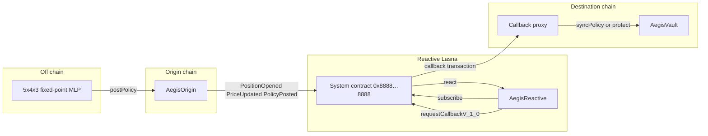

# Aegis

A small neural net sets a stop. A Reactive contract applies it to each new price. The destination vault pauses or closes a mock position only when its own entry price agrees.

Built by Ali Ghaedi (`halfabillion`) for the Reactive Omni Buildathon, track **Reactive Meets AI**. The rules that were actually read are in [RULES.md](RULES.md). The testnet loop has been run on Base Sepolia and Lasna. Addresses and hashes are in [DEPLOYMENTS.md](DEPLOYMENTS.md). The official judging demo is [video/aegis-demo.mp4](video/aegis-demo.mp4) (93 seconds, 1920×1080, voice-over and captions).

## Problem

A fixed on-chain stop is brittle. A quiet market does not need a 2% trigger, and a fast selloff should not wait for a 15% one. A model can retune that width as prices arrive. It should not be able to close a position by itself: the chain still has to see the drawdown.

Aegis splits that. The model publishes a policy. The reactive contract decides whether the latest price meets it. The vault repeats the arithmetic on its own entry and refuses the call when it does not.

## How it uses Reactive

`AegisReactive` is an Omni reactive contract. It inherits `AbstractReactive` from [reactive-lib-omni](https://github.com/Reactive-Network/reactive-lib-omni) `v0.1.0`.

In the constructor it calls `SYSTEM.subscribe` three times, all on the origin contract, with `REACTIVE_IGNORE` on topics 1–3:

- `PositionOpened(uint256,uint256,uint256)`
- `PriceUpdated(uint256,uint256,uint64)`
- `PolicyPosted(uint256,uint64,uint16,uint8,uint16,bytes32)`

`react` is `onlySystem`. It ignores logs from the wrong chain, the wrong contract, or with an `opCode` other than 2. It returns on logs it does not care about, instead of reverting.

- A position log stores the entry.
- A policy log is stored only when confidence is at least 5500 bps, the epoch is newer, and the action is hold, arm, or pause. The stop is clamped to 100–2000 bps. A passing policy requests `syncPolicy`.
- A price log requests `protect` only when the stored policy and the drawdown agree. Hold never fires. Pause fires at half the posted stop. Arm fires at the full stop. A second arm does not send another stop.

Both callbacks go through `SYSTEM.requestCallbackV_1_0`. The gas limit is `1_000_000`. The destination chain id and the vault address are fixed at deploy, with the vault set afterwards because the callback contract needs the reactive address first. The first argument of every payload is `address(0)`. That is the placeholder the network replaces.

`AegisVault` inherits `AbstractCallback`. `syncPolicy` and `protect` use `onlyServiceProvider` and `onlyCallbackSender`. `protect` recomputes the drawdown from the vault's own entry. It also rejects a stale timestamp, a timestamp more than five minutes in the future, a mismatched epoch or action, and a hold. Pause freezes the mock position. Arm marks it closed. There is no token and no exchange. The size is an integer recorded at open.

The off-chain piece is `scorer/`. It is a 5×4×3 network: ReLU hidden units, a rational sigmoid, integer weights in `scorer/weights.json`. The five inputs are the last absolute return, mean absolute return, drawdown from the window peak, drawdown from entry, and the share of down ticks. The policy head maps the outputs to a stop width, an action, and a confidence. Confidence below 5500 bps becomes hold, which the contract rejects. The weights are hand-set so three fixtures separate: a quiet book stays armed, a three-step 1% grind pauses, and a seven-step 3% crash closes. They were not fit on market data. `scorer/llm_hook.py` can POST a summary, and only if the caller passes `enabled=True` and a URL. The scorer and the demo do not enable it.

## Architecture



The local demo does not have Lasna or a callback proxy. Anvil plays every chain. A copy of `MockSystem` is etched at `0x8888…8888` so the real `SYSTEM` constant is what the constructor calls. `CallbackRelay` stands in for the destination proxy: it overwrites the first ABI address argument and calls the vault. The demo reads the origin receipt and passes that log into `react`.

## What the tests and the demo prove

`forge test` (23 tests, one of them a 256-run fuzz) proves the Solidity loop against the mock:

- the constructor records three subscriptions for Ethereum Sepolia chain id `11155111`, the origin address, the three event topics, and `REACTIVE_IGNORE`
- `react` from any other caller reverts `NotAuthorized`
- an origin `PositionOpened` and `PriceUpdated` log, captured with `vm.recordLogs`, update reactive storage
- confidence of 5499 bps and a repeated epoch are rejected and do not request a callback
- a stop of 50_000 bps is clamped to 2000 before `syncPolicy`
- an armed 1000 bps stop at a 1000 bps drawdown requests one callback to chain id `84532`, gas `1_000_000`, with `address(0)` still in the payload; the relay inserts the reactive address and the vault closes
- a second, deeper price does not request another stop
- pause fires at 500 bps and not at 499, and the position stays open
- hold does not fire at a price of 1
- a direct vault call, a callback whose injected sender is wrong, a 500 bps dip against a 1000 bps arm, a two-hour-old timestamp, and a timestamp a day ahead all revert
- the vault rejects a synced stop of 1 bps, so a bypass of the clamp does not stick
- `coverDebt` at zero debt does not revert
- `keccak256(abi.encode(uint256[5](1, 2, 3, 4, 5)))` is `0x5917e5a395fb9b454434de59651d36822a9e29c5ec57474df3e67937b969460c`, the same vector the Python tests hash

`python3 -m unittest discover -s scorer -v` (9 tests) proves the scorer is deterministic, that the calm / grind / crash / wick fixtures take the actions above, that bad windows raise, and that the default path does not open a socket.

`./demo/demo.sh` deploys the same contracts on a fresh Anvil and runs the scorer through them. The last run printed five callback requests: sync of the calm policy, sync and pause on the grind, sync and stop on the crash. The wick was rejected. A hand-built 2% protect reverted `ConditionsNotMet(200, 911)` while the calm stop was 911 bps. Anvil's unlocked account `0xf39Fd6e51aad88F6F4ce6aB8827279cffFb92266` sends the transactions. Its key is not in this repo.

Re-ran on 10 Nov 2026: those 23 Foundry tests, the 9 scorer tests, and `./demo/demo.sh` all passed. That Anvil run is separate from the testnet. On Base Sepolia and Lasna the same windows were posted for real: the grind paused the vault, and the crash closed it. The crash origin event, the Lasna `react`, and the Base Sepolia stop callback are in [DEPLOYMENTS.md](DEPLOYMENTS.md). No latency number was measured.

## Quickstart

Requires Git, Python 3.11 or newer, and Foundry (forge, cast, anvil).

```bash
git clone --recurse-submodules https://github.com/halfabillion/aegis-reactive.git
cd aegis-reactive
curl -L https://foundry.paradigm.xyz | bash
foundryup
export PATH="$HOME/.foundry/bin:$PATH"
forge test
python3 -m unittest discover -s scorer -v
./demo/demo.sh
```

The Python scorer uses only the standard library plus `cast keccak` for the features hash. No API key is read. `AEGIS_LLM` is not a switch the demo sets.

Score one window from the shell:

```bash
python3 -m scorer.aegis_scorer \
  --entry 100000000000 \
  --epoch 1 \
  --prices 100000000000,100100000000,99900000000,100000000000
```

## Tests

```bash
forge test
forge test -vv --match-test test_vaultRejectsDisagreement
python3 -m unittest discover -s scorer -v
```

## Deployment

The throwaway deployer `0x3E3B3480E0f538738aEfa759648511042Ac2bDf3` sent 0.048 Ethereum Sepolia ETH to the Reactive faucet and received 5.04 lREACT on Lasna. `./script/deploy_testnet.sh` and `./script/trigger_testnet.sh` then ran with `AEGIS_VAULT_FUND=0.00002ether`. The key stayed in an untracked `.secrets/` file and is not in this repository.

- Origin (Base Sepolia) and reactive (Lasna): [`0x963E8F3a86745A86e72616D0f5809E47841BEA11`](https://sepolia.basescan.org/address/0x963E8F3a86745A86e72616D0f5809E47841BEA11)
- Vault (Base Sepolia): [`0x5FBb41e5C7e396b09a823B393d7EFA91E0702298`](https://sepolia.basescan.org/address/0x5FBb41e5C7e396b09a823B393d7EFA91E0702298)
- Callback proxy (Base Sepolia): `0x476F44b11F5C942c58f4c8E3d0300E5710743585`
- Crash `pushPrice`: [`0x3ee6064a848d7b12509f04e03c118e5a5f2c2f0e5ebaa067e9d26c806e9d7f51`](https://sepolia.basescan.org/tx/0x3ee6064a848d7b12509f04e03c118e5a5f2c2f0e5ebaa067e9d26c806e9d7f51)
- Lasna `react` (stop requested): [`0x09950b9198f059bb14ac1b588b188b1e0c2fab88c21286e1966f8f711e1d2c27`](https://lasna.reactscan.net/tx/0x09950b9198f059bb14ac1b588b188b1e0c2fab88c21286e1966f8f711e1d2c27)
- Stop callback: [`0xc97663076f6aa11c5e86e01c79ce08513a11f0bd649c95fa7db19f80a671156c`](https://sepolia.basescan.org/tx/0xc97663076f6aa11c5e86e01c79ce08513a11f0bd649c95fa7db19f80a671156c)

Every other hash is in [DEPLOYMENTS.md](DEPLOYMENTS.md). Sourcify verification was not run. The vault's age check uses timestamps, which is what Base Sepolia's 200 ms blocks require.

To run the scripts yourself, keep the key local. Do not put a key, a seed, or a funded amount into this repo:

```bash
export BASE_SEPOLIA_RPC="<from Chainlist>"
export LASNA_RPC="https://lasna-rpc.rnk.dev/"
export PRIVATE_KEY="<local only>"
./script/deploy_testnet.sh
./script/trigger_testnet.sh
```

## Limitations

- The recorded testnet loop is one crash path (origin `pushPrice`, Lasna `react`, Base Sepolia stop callback) plus an earlier grind pause. Sourcify verification was not run.
- The mock system records subscriptions and callbacks. It does not charge gas, keep debt, or talk to a real callback proxy.
- The relay's address injection matches the callback-contract docs. It was not compared with a live Lasna trace.
- The position is a number in storage. Nothing is swapped or withdrawn.
- One origin owner pushes both prices and policies.
- The network is small, fixed-point, and hand-weighted. A recovered wick becomes hold because confidence falls under 5500 bps on that fixture, not because the net was trained on wick data.
- The optional HTTP hook is untested against a live model and is off.
- The vault can be opened once per feed id.
- No latency figures. That measurement belongs to the Every Second Counts track, and it needs the real loop.

## License

MIT, for the Aegis source. `lib/reactive-lib-omni` stays under the upstream `UNLICENSED` headers. `lib/forge-std` stays under its upstream MIT and Apache-2.0 licenses.
